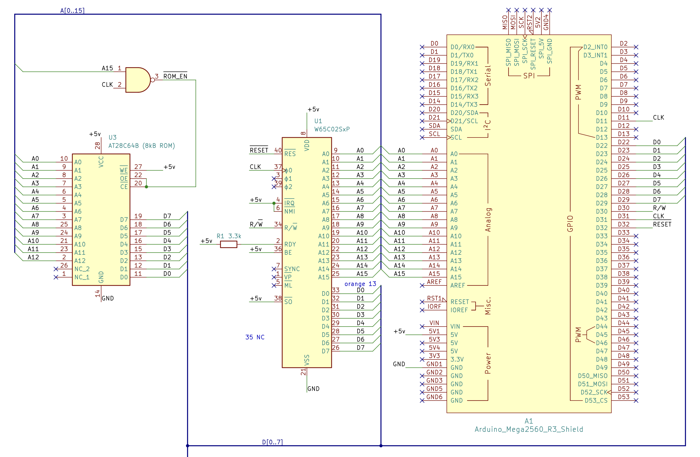
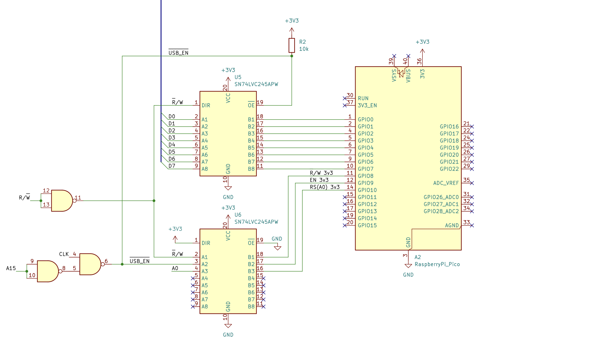
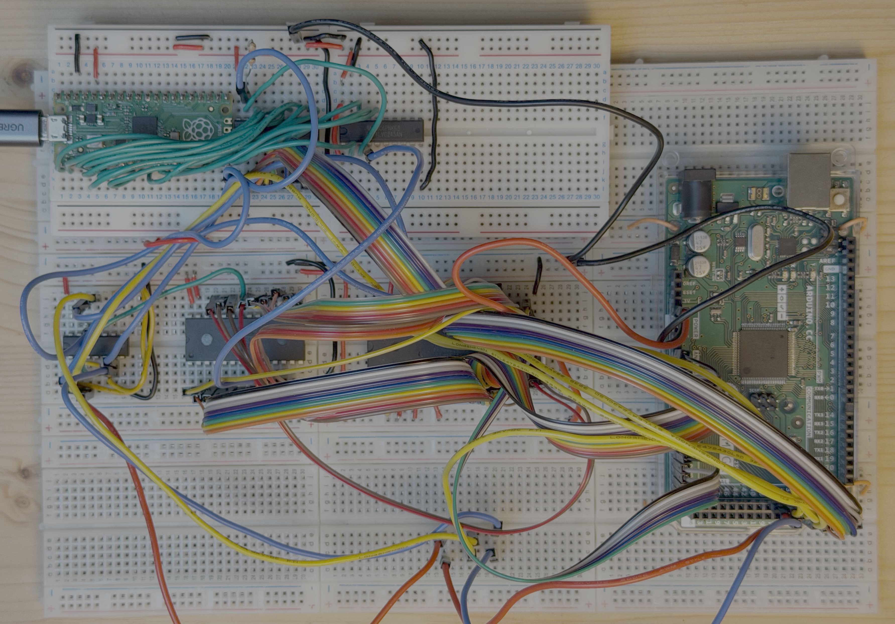
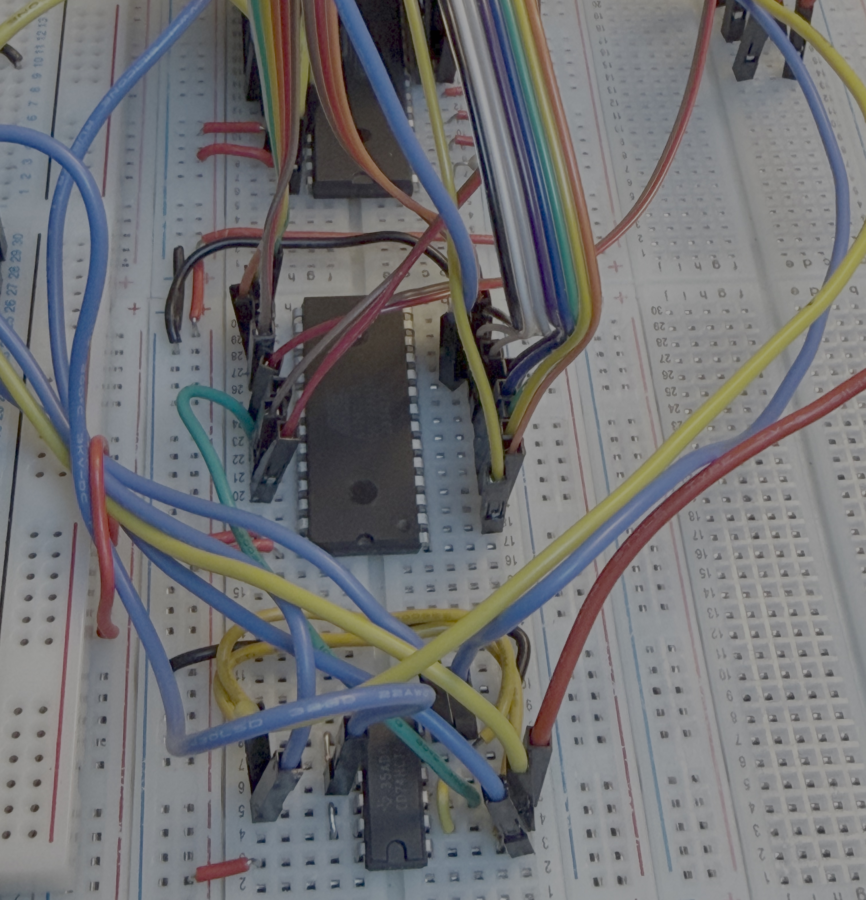
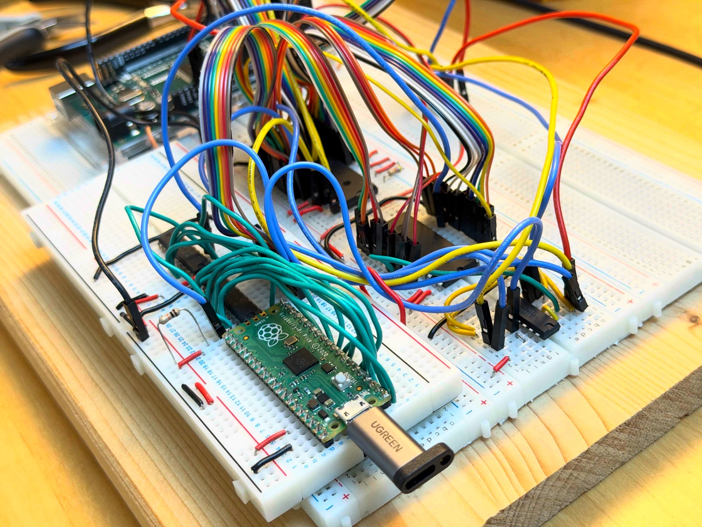
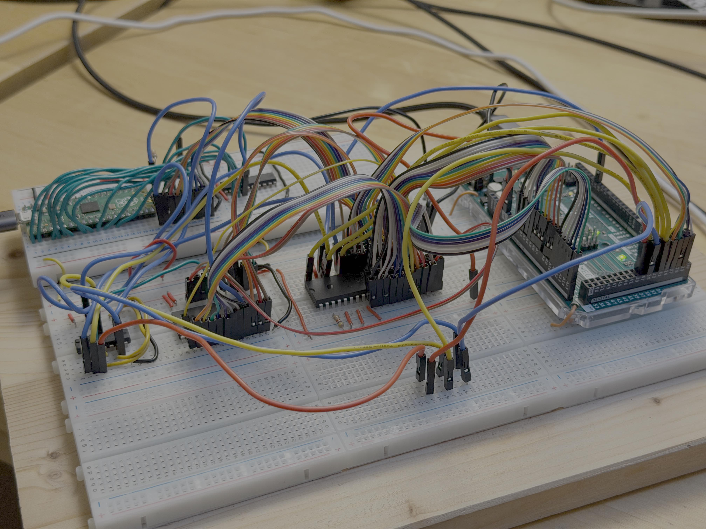

# 6502 experiment 1

[PainfulDiodes blog post](https://painfuldiodes.wordpress.com)

Following on from [experiment zero](../6502-experiment-000/), where an Arduino Mega fed the W65C02S an endless stream of NOPs, this experiment replaces the Arduino's fake memory with a real AT28C64B EEPROM, adds address decoding with a single 74HCT00, and connects a breadboard BeanPort USB interface. The 6502 runs programs from the EEPROM, ending with one that echoes characters typed into a terminal on the Mac.

## Contents

- `6502/` – test programs (ca65), built with `scripts/build.sh` (cl65) and burned with `scripts/burn.sh` (minipro)
  - `00_nop` – EEPROM full of NOPs
  - `01_port_read` – read a "port" in a loop
  - `02_reset_vector` – start from a reset vector
  - `03_echo` – blind echo through BeanPort
  - `04_echo_polled` – echo polling BeanPort's status register
- `arduino/clock_fixed/` – Mega sketch providing a fixed 2MHz clock and reset
- `kicad/bean65/` – schematic

## Images

